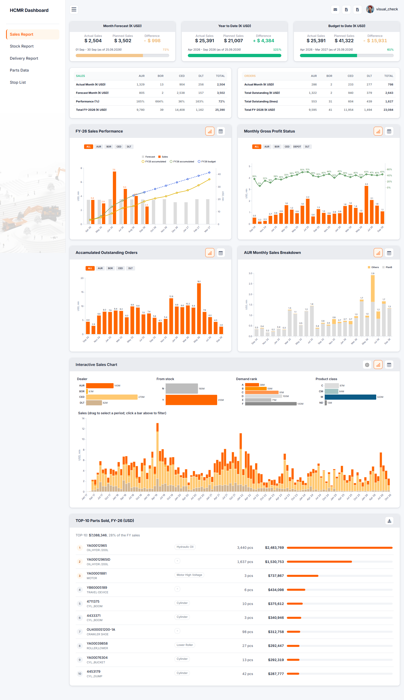
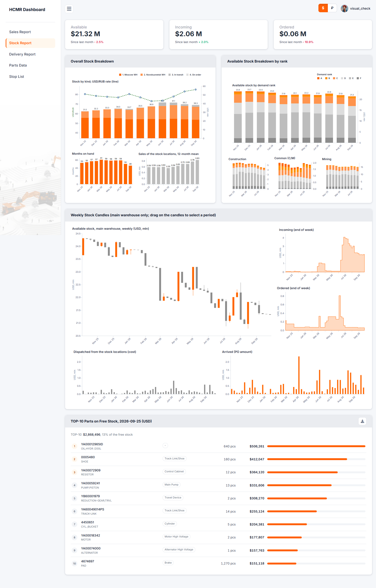
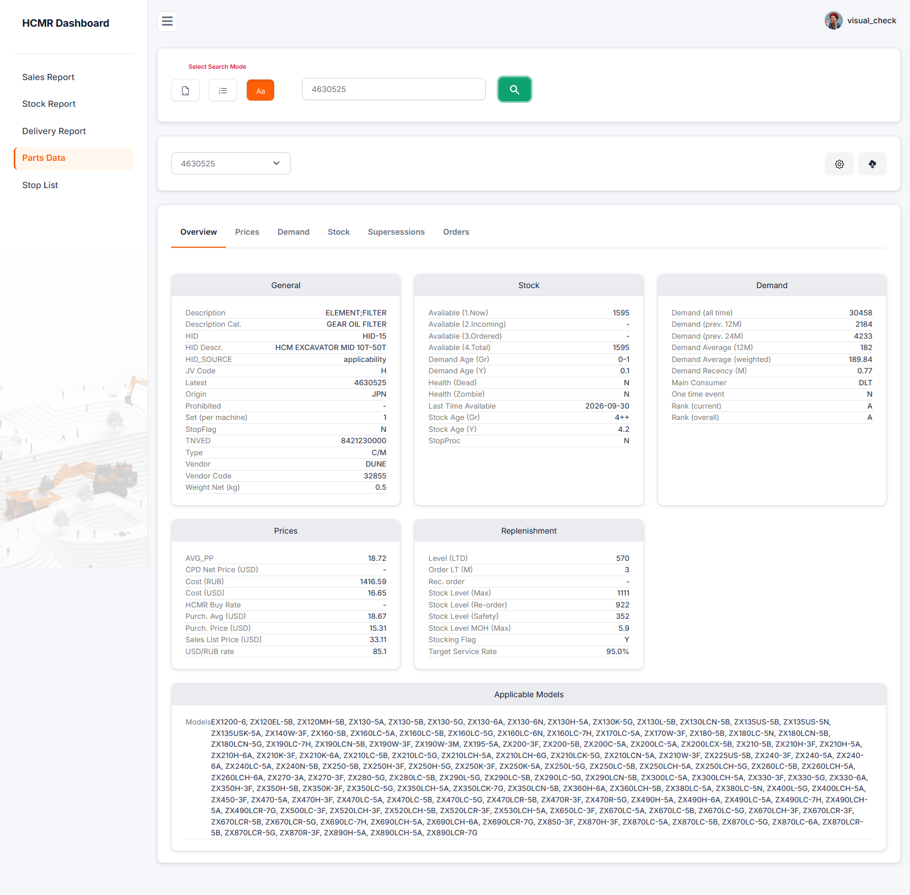
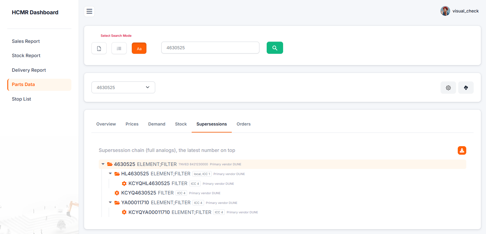

# HCMR Parts Dashboard

[](https://github.com/BorodaPetra/hcmr-dashboard/actions/workflows/lint.yml)

**Русский** · [English](README.md)

Flask-дашборд отчётности по запчастям: продажи против бюджета, оценка склада, поставки, карточка детали. Отчёты собираются запросами к витринам нормализованного PostgreSQL-хранилища (`reporting.order_line_flow`, `ref.part_full`, `ref.part_pnl`, …). На скриншотах демо-база: анонимизированные данные с синтетическим продолжением.

**Предыстория.** Дашборд начинался как pet-проект. Затем его включили в рабочий процесс департамента, и он расширялся по мере необходимости. Работал на удалённом сервере внутри корпоративной сети, примерно 30–50 пользователей.

| Sales: продажи против бюджета | Stock: оценка склада |
|---|---|
| [](docs/screenshots/sales.png) | [](docs/screenshots/stock.png) |
| **Parts Data: карточка детали** | **Parts Data: дерево замен** |
| [](docs/screenshots/parts.png) | [](docs/screenshots/parts_tree.png) |

**Стек:** Python 3.12 · Flask 3 (Flask-Login, Flask-WTF) · SQLAlchemy 2 + psycopg 3 · pandas 3 · Altair 6 / Vega-Lite 6 · Bootstrap 5 · gunicorn + nginx · Docker · uv

## Что умеет

- **Sales:** продажи и заказы по группам дилеров против бюджета финансового года, накопленные открытые заказы, валовая прибыль по месяцам, интерактивный график с фильтрами по периоду, дилеру, рангу спроса и классу продукта, TOP-10 деталей с выгрузкой в xlsx. Загрузка бюджета (xlsx) администратором.
- **Рассылка:** ежедневный отчёт и месячная разбивка по почте, по cron через CLI или кнопкой администратора.
- **Stock:** стоимость склада в USD и RUB по месяцам и рангам спроса, месяцы запаса, недельные свечи основного склада, поступления и отгрузки, TOP-10 деталей на свободном остатке.
- **Delivery:** загруженный файл отслеживания контейнеров дополняется поставщиком и суммой счетов из хранилища; график и таблица статусов поставки.
- **Parts Data:** поиск одного номера (с подсказками), списка или файла xlsx. Карточка детали: цены, спрос, модель рангов, склад, пополнение. Дерево замен всей цепочки, заказы SO и PO по детали.
- **Stop List:** загрузка списка артикулов и флаг в Parts Data.
- **Пользователи и роли:** вход, регистрация как заявка на доступ, которую одобряет администратор, управление пользователями и ролями.

## Как устроено

- **Состояние отчётов.** Отчёт собирается один раз в фоне и живёт в памяти процесса до ночной загрузки (`REPORT_REFRESH_TIME`). Прогрев при старте воркера собирает все отчёты по очереди, общие фреймы Sales и Stock строятся один раз на прогрев. Во время пересборки видно прежнее состояние. → [`reports/common/state.py`](src/dashboard/reports/common/state.py)
- **Отчёт как пакет.** Каждый отчёт — пакет в `reports/`: `register_blueprints` находит его сам, адрес страницы — `/report/<пакет>`.
- **Безопасность.** Вход только по учётке, CSRF на всех POST, CSP только со своими скриптами и nonce, проверка загрузок (формат, размер, фиксированное имя), заголовки безопасности. Пароль к базе в Docker-секрете, не в окружении.

## Эндпоинты

Все маршруты, кроме `/login` и `/register`, требуют входа; ✱ — только для роли Admin. Каждый POST несёт CSRF-токен.

| Метод | Путь | Что делает |
|---|---|---|
| GET, POST | `/login`, `/register`; GET `/logout` | вход, заявка на доступ, выход |
| GET, POST | `/profile` | свой профиль |
| GET | `/users`, `/roles` ✱ | таблицы пользователей и ролей; создание, правка и удаление — `/user-*`, `/role-*` ✱ |
| GET | `/` | главная с карточками отчётов |
| GET | `/report/sales` | отчёт Sales |
| POST | `/report/sales/process` | JSON: детальный график за выбранный период и по выбранным дилерам |
| POST | `/report/sales/upload` ✱ | бюджет финансового года (xlsx) |
| POST | `/report/sales/send/<daily\|breakdown>` ✱ | отправить рассылку сейчас |
| GET | `/report/sales/top_parts.xlsx`, `/report/stock/top_parts.xlsx` | TOP-10 в xlsx |
| GET | `/report/stock` | отчёт Stock |
| GET, POST | `/report/delivery` | отчёт Delivery; POST ✱ загружает файл отслеживания |
| GET | `/report/parts` | страница Parts Data |
| POST | `/report/parts/processing` | JSON: данные запрошенных деталей (`{"parts": [...]}`, до 500) |
| GET | `/report/parts/suggest?q=` | JSON: номера, начинающиеся с `q` |
| GET | `/report/parts/supersessions?part=` | JSON: дерево замен детали |
| GET | `/report/parts/orders?part=` | JSON: заказы SO и PO детали |
| GET, POST | `/stop-list`; POST `/stop-list/remove` | стоп-лист; POST ✱ загружает или удаляет номера |

## Запуск

**Нужно:** Python 3.12, [uv](https://docs.astral.sh/uv/), PostgreSQL с демо-базой `hcmr_demo` (схема хранилища с анонимизированными и синтетическими данными; сама база в репозиторий не входит).

```powershell
uv sync
# .env: SECRET_KEY=<случайная строка>
#       DATABASE_URL=postgresql+psycopg://dashboard_app@localhost:5432/hcmr_demo  (пароль — в pgpass.conf)
#       остальные настройки — в .env.example
uv run flask --app wsgi init-db
uv run flask --app wsgi create-admin admin
uv run flask --app wsgi run --debug

# рассылка (cron на сервере); вручную — кнопки на странице Sales (Admin)
uv run flask --app wsgi send-reports
```
Docker (gunicorn + nginx, база снаружи): [docs/deploy.md](docs/deploy.md).

> Оговорка к демо-данным: около 46 синтетических строк back-order у поставщика без цены закупки. Их себестоимость считается нулём, поэтому валовая прибыль синтетического периода (после 2026-06-11) завышена примерно на 40 тыс. USD.

## Структура
```
src/dashboard/
  __init__.py config.py cli.py    фабрика приложения, настройки из окружения, команды flask
  uploads.py utils.py             общее для всего приложения: проверка загрузок, редирект
  authentication/ home/ stoplist/ разделы приложения (blueprints)
  data/                           запросы к витринам хранилища, кэш
  reports/
    common/                       общее для отчётов: состояние и прогрев, общие фреймы,
                                  daily, группы дилеров, цены, тема графиков
    sales/ stock/ delivery/ parts/  по пакету на отчёт: routes, report (сборка), charts, свои фреймы
  templates/ static/
scripts/                          демо-бюджет, скрипты сверки (reconcile/)
instance/                         рабочие файлы (загрузки), не в git и не в образе
```

## Лицензия

[MIT](LICENSE). Оформление основано на [Volt](https://themesberg.com/product/admin-dashboard/volt-bootstrap-5-dashboard) от Themesberg (MIT), уведомление об авторстве сохранено в `static/assets/css/volt.css`.
